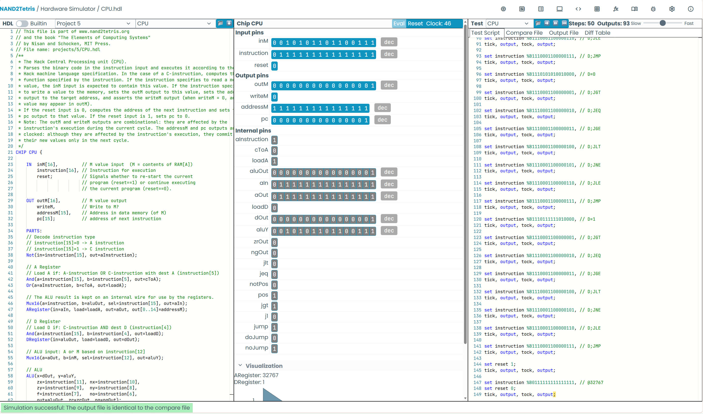
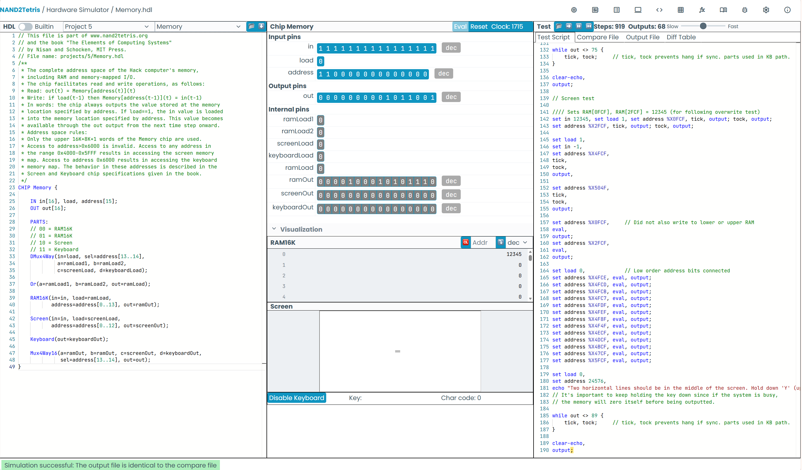
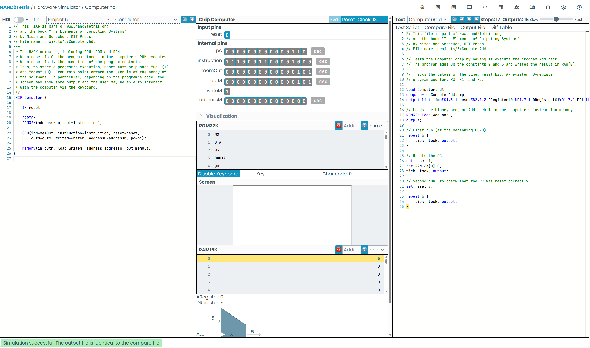
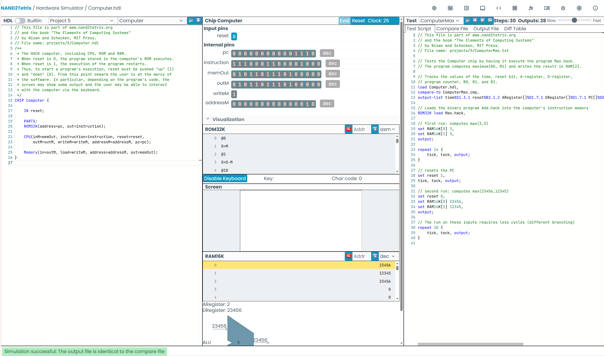
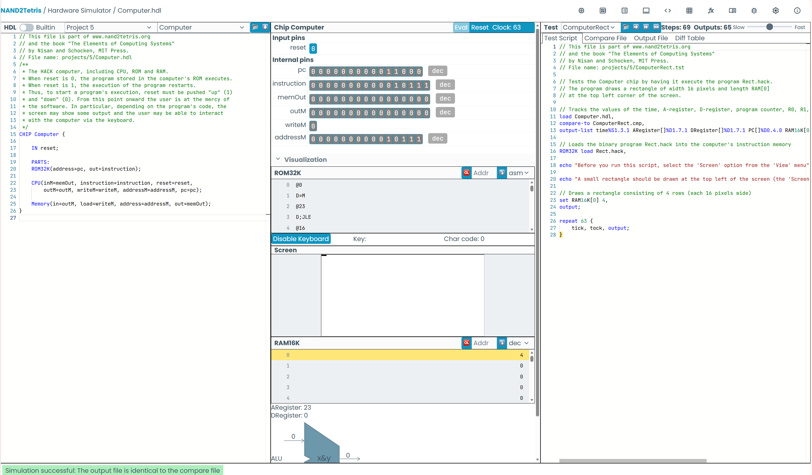
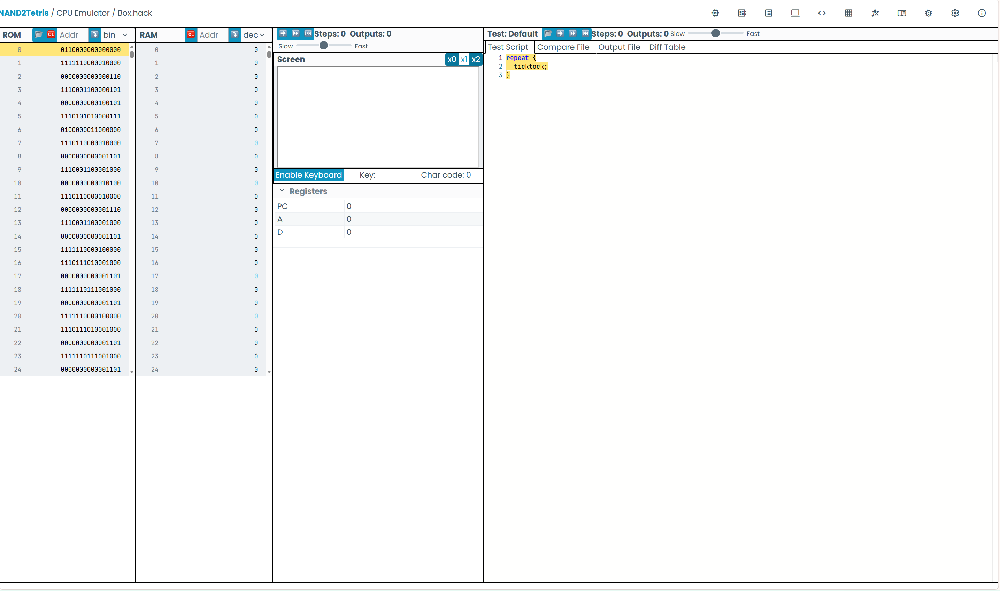
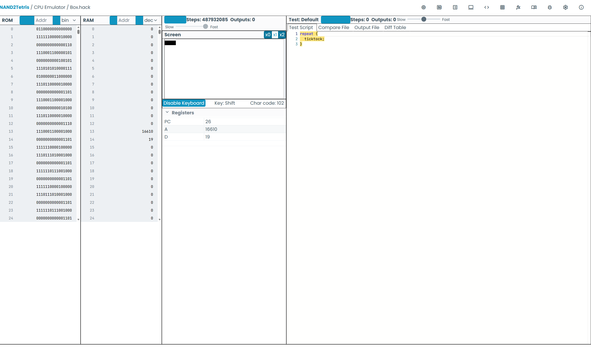

# Nand2Tetris Capstone Project: Make the Computer Draw a Box

**Course:** Nand to Tetris I (ETCCNT301)\
**Student:** Prabhat Bhatia\
**Roll Number:** 2501410006\
**Personal Number (K):** 06\
**Project:** Individual capstone

---

## Project Overview

This project implements a small Hack computer system and a Hack assembly program that displays a black rectangle on the screen while a keyboard key is pressed. When the key is released, the same screen area is cleared.

The work is divided into the three parts specified in the capstone brief:

- **Part A -- Build the computer:** connect the CPU, memory and computer-level chips and verify them with the supplied test scripts.
- **Part B -- Write a Python assembler:** translate Hack assembly instructions into 16-bit machine instructions, using a two-pass process and supporting the required symbol-table output for this roll number.
- **Part C -- Write the box program:** use the assembler from Part B to generate `Box.hack`, then run it in the CPU Emulator.

The source files, generated machine-code files, test programs and screenshots are kept in this `capstone` directory.

## Personal Configuration

The assignment uses the last two digits of the roll number as the personal number:

| Item | Value |
|:---|---:|
| Roll number | `2501410006` |
| K | `06` |
| Starting screen row | `6` |
| Box height | `20` rows |
| Box width | `48` pixels |
| Words per screen row | `32` |
| Words used by the box in each row | `3` |

The width is calculated using the assignment formula:

$$16 \times ((K \bmod 4) + 1) = 16 \times ((6 \bmod 4) + 1) = 48\text{ pixels}$$

A Hack screen row contains 32 words, and each word represents 16 horizontal pixels. The screen begins at address 16384. Therefore, the first word of the box is:

$$16384 + (32 \times 6) = 16576$$

The box occupies three consecutive screen words on each of 20 rows, beginning at address 16576.

---

## Repository Contents

```text
capstone/
├── screenshots/
│   ├── Box_Program_Loaded.png
│   ├── Box_Black_Box.png
│   ├── Box_Cleared.png
│   ├── Computer.hdl_ComputerAdd.tst.png
│   ├── Computer.hdl_ComputerMax.tst.png
│   ├── Computer.hdl_ComputerRect.tst.png
│   ├── CPU.hdl_CPU.tst.png
│   └── Memory.hdl_Memory.tst.png
│
├── tests/
│   ├── Add.asm
│   ├── Add.hack
│   ├── Max.asm
│   ├── Max.hack
│   ├── Pong.asm
│   ├── Pong.hack
│   ├── Rect.asm
│   └── Rect.hack
│
├── assembler.py
├── Box.asm
├── Box.hack
├── Computer.hdl
├── CPU.hdl
├── Memory.hdl
└── symbols.txt
```

The screenshots listed above are stored in the `screenshots/` directory. The test `.asm` files are the assembly inputs, while the corresponding `.hack` files are their machine-code outputs.

---

## Part A -- Building the Hack Computer

### Objective

The first part combines the hardware components into the three top-level chips required by the assignment:

- `CPU.hdl`
- `Memory.hdl`
- `Computer.hdl`

The CPU executes instructions, the memory chip provides access to RAM and the memory-mapped screen and keyboard, and the Computer chip connects the CPU, memory and instruction ROM.

### Implementation

#### CPU.hdl

The CPU implementation connects the instruction decoder, registers, ALU and program counter. It handles the Hack instruction cycle and produces the memory address, data output and write signal needed to communicate with memory.

#### Memory.hdl

The memory implementation connects the RAM, screen and keyboard components. It uses the Hack memory map:

| Component | Address range / address |
|:---|---:|
| RAM | `0`--`16383` |
| Screen | Starts at `16384` |
| Keyboard | `24576` |

The screen and keyboard are accessed through memory addresses, rather than through separate input or output instructions.

#### Computer.hdl

The Computer chip connects the CPU to the instruction ROM and the Memory chip. It provides the complete computer-level structure used by the supplied integration tests.

### Part A Test Results

The following supplied test scripts were run:

| Test | Result |
|:---|:---|
| `CPU.tst` | Passed |
| `Memory.tst` | Passed |
| `ComputerAdd.tst` | Passed |
| `ComputerMax.tst` | Passed |
| `ComputerRect.tst` | Passed |

### Screenshots

**CPU test**



**Memory test**



**Computer Add test**



**Computer Max test**



**Computer Rect test**



---

## Part B -- Python Hack Assembler

### Objective

The second part implements a Python assembler that reads a `.asm` file and converts each valid Hack instruction into a 16-bit binary instruction in a `.hack` file.

The assembler uses two passes, as required by the assignment.

### How the Assembler Works

#### Reading and cleaning the source

The assembler reads the input file, removes comments and blank lines, and retains the original line numbers so that invalid instructions can be reported against their source lines.

#### First pass: labels

The first pass scans the instructions and records labels such as `(LOOP)` with their corresponding ROM instruction addresses. Label declarations do not themselves occupy ROM instruction addresses.

#### Second pass: machine-code generation

The second pass translates A-instructions and C-instructions into their 16-bit binary representations.

For symbols that are neither predefined symbols nor labels, the assembler allocates variable addresses beginning at RAM address 16, then continues with 17, 18 and so on.

The assembler writes the generated machine code to a `.hack` file beside the input `.asm` file.

### Required Extra Feature for K = 06

The assignment selects an additional assembler feature using `K mod 3`.

$$6 \bmod 3 = 0$$

Therefore, this implementation must save labels and variables with their addresses in `symbols.txt`.

The assembler writes the symbols found during assembly to this file. For the `Rect.asm` test, the recorded output was:

```text
LOOP 10
INFINITE_LOOP 23
counter 16
address 17
```

This shows the two labels and the two variables, including their respective ROM and RAM addresses.

### Assembler Implementation Code (`assembler.py`)

The full Python source code of the two-pass assembler is included below:

```python
import re
import sys
from pathlib import Path

SYMBOLS = {
    "SP": 0, "LCL": 1, "ARG": 2,
    "THIS": 3, "THAT": 4,
    "SCREEN": 16384, "KBD": 24576
}

for i in range(16):
    SYMBOLS["R" + str(i)] = i

COMP = {
    "0": "0101010", "1": "0111111", "-1": "0111010",
    "D": "0001100", "A": "0110000", "!D": "0001101",
    "!A": "0110001", "-D": "0001111", "-A": "0110011",
    "D+1": "0011111", "A+1": "0110111",
    "D-1": "0001110", "A-1": "0110010",
    "D+A": "0000010", "D-A": "0010011",
    "A-D": "0000111", "D&A": "0000000",
    "D|A": "0010101",
    "M": "1110000", "!M": "1110001", "-M": "1110011",
    "M+1": "1110111", "M-1": "1110010",
    "D+M": "1000010", "D-M": "1010011",
    "M-D": "1000111", "D&M": "1000000",
    "D|M": "1010101"
}

DEST = {
    "": "000",
    "A": "100",
    "D": "010",
    "M": "001",
    "AD": "110",
    "AM": "101",
    "DM": "011",
    "ADM": "111"
}

JUMP = {
    "": "000", "JGT": "001", "JEQ": "010",
    "JGE": "011", "JLT": "100", "JNE": "101",
    "JLE": "110", "JMP": "111"
}


def valid_symbol(symbol):
    return re.fullmatch(r"[A-Za-z_.$:][A-Za-z0-9_.$:]*", symbol) is not None


def clean_file(filename):
    instructions = []

    with open(filename, "r") as file:
        for number, original in enumerate(file, start=1):
            line = original.split("//")[0]
            line = re.sub(r"\s+", "", line)

            if line:
                instructions.append((number, line))

    return instructions


def first_pass(instructions):
    symbols = SYMBOLS.copy()
    labels = {}
    errors = []
    rom_address = 0
    remaining = []

    for number, line in instructions:
        if line.startswith("(") or line.endswith(")"):
            if not (line.startswith("(") and line.endswith(")")):
                errors.append((number, "Invalid label"))
                continue

            label = line[1:-1]

            if not valid_symbol(label):
                errors.append((number, "Invalid label"))
            elif label in symbols:
                errors.append((number, "Duplicate or reserved label"))
            else:
                symbols[label] = rom_address
                labels[label] = rom_address

        else:
            remaining.append((number, line))
            rom_address += 1

    return remaining, symbols, labels, errors


def second_pass(instructions, symbols):
    output = []
    variables = {}
    errors = []
    next_variable = 16

    for number, line in instructions:
        try:
            if line.startswith("@"):
                symbol = line[1:]

                if not symbol:
                    raise ValueError()

                if symbol.isdigit():
                    address = int(symbol)

                    if address > 32767:
                        raise ValueError()

                else:
                    if not valid_symbol(symbol):
                        raise ValueError()

                    if symbol not in symbols:
                        symbols[symbol] = next_variable
                        variables[symbol] = next_variable
                        next_variable += 1

                    address = symbols[symbol]

                output.append(format(address, "016b"))

            else:
                if line.count("=") > 1 or line.count(";") > 1:
                    raise ValueError()

                if ";" in line:
                    instruction, jump = line.split(";")
                else:
                    instruction, jump = line, ""

                if "=" in instruction:
                    dest, comp = instruction.split("=")
                    dest = "".join(sorted(dest))
                else:
                    dest, comp = "", instruction

                if dest not in DEST or comp not in COMP or jump not in JUMP:
                    raise ValueError()

                binary = "111" + COMP[comp] + DEST[dest] + JUMP[jump]
                output.append(binary)

        except (ValueError, KeyError):
            errors.append((number, "Invalid instruction"))

    return output, variables, errors


def assemble(filename):
    path = Path(filename)

    instructions = clean_file(path)
    instructions, symbols, labels, errors = first_pass(instructions)

    output, variables, second_errors = second_pass(instructions, symbols)
    errors.extend(second_errors)

    if errors:
        for number, message in errors:
            print(f"Line {number}: {message}")

        print("Assembly failed. No .hack file generated.")
        return

    output_file = path.with_suffix(".hack")
    output_file.write_text("\n".join(output) + "\n")

    # Save labels and variables for K = 06
    with open("symbols.txt", "w") as file:
        for name, address in {**labels, **variables}.items():
            file.write(f"{name} {address}\n")

    print("Assembly successful!")
    print("Output:", output_file)
    print("Instructions:", len(output))
    print("Symbols saved to symbols.txt")


if __name__ == "__main__":
    if len(sys.argv) != 2:
        print("Usage: python assembler.py filename.asm")
    else:
        try:
            assemble(sys.argv[1])
        except OSError as error:
            print("File error:", error)
```

### Assembler Tests

The assembler was run on the four programs specified in the assignment:

| Program | Source | Generated machine code |
|:---|:---|:---|
| Add | `tests/Add.asm` | `tests/Add.hack` |
| Max | `tests/Max.asm` | `tests/Max.hack` |
| Rect | `tests/Rect.asm` | `tests/Rect.hack` |
| Pong | `tests/Pong.asm` | `tests/Pong.hack` |

The generated outputs were compared instruction by instruction against the corresponding reference `.hack` files. All four comparisons matched exactly.

### Running the Assembler

Run these commands from the `capstone` directory:

```powershell
python assembler.py tests/Add.asm
python assembler.py tests/Max.asm
python assembler.py tests/Rect.asm
python assembler.py tests/Pong.asm
```

To assemble the Part C program:

```powershell
python assembler.py Box.asm
```

The generated `Box.hack` file is then loaded into the CPU Emulator.

---

## Part C -- Make the Computer Draw a Box

### Objective

The final part uses Hack assembly to display a black box while any key is pressed. When the key is released, the program clears the same area of the screen.

The program is written in `Box.asm` and translated using the Python assembler developed in Part B. The resulting machine-code file is `Box.hack`.

### Box Dimensions and Screen Address

For roll number `2501410006`, the personal number is `K = 06`.

| Property | Required value |
|:---|---:|
| Starting row | `6` |
| Height | `20` rows |
| Width | `48` pixels |
| Words per row occupied | `3` |
| Starting screen address | `16576` |

The program starts at screen address 16576. For each row, it writes to three consecutive screen words. It then advances to the corresponding position on the next screen row.

### Keyboard and Screen Memory

The program reads the keyboard through the memory-mapped keyboard address:

- `KBD` = `24576`
- A non-zero keyboard value indicates that a key is pressed.
- A zero value indicates that no key is pressed.

For screen output:

- `SCREEN` begins at `16384`.
- Writing `-1` to a screen word sets all 16 pixels in that word to black.
- Writing `0` clears those pixels to white.

### Program Flow

- The program checks the keyboard.
- If a key is pressed, execution enters the drawing routine.
- The drawing routine initializes the screen pointer to 16576 and the row counter to 20.
- It writes `-1` to three consecutive words in each row.
- After 20 rows, the program returns to keyboard checking.
- If no key is pressed, execution enters the clearing routine.
- The clearing routine writes `0` to the same three words in each of the 20 rows.
- After clearing the area, the program returns to keyboard checking.

The program uses `R13` as the screen address pointer and `R14` as the row counter.

### Running the Program

From the `capstone` directory, assemble the program using the project's own assembler:

```powershell
python assembler.py Box.asm
```

This generates `Box.hack`.

Open the Nand2Tetris CPU Emulator, load `Box.hack`, and run the program. Pressing a key should display the black rectangle. Releasing the key should clear it.

### Part C Screenshots

**Box program loaded in the CPU Emulator**



**Key pressed: black box displayed**



**No key pressed: box cleared**


---

## Mistake Encountered and Fixed

During the box implementation, the rectangle initially appeared diagonally instead of maintaining the same horizontal starting position on every row. The issue was in the screen address calculation. Each screen row contains 32 words. The program writes three consecutive words, leaving the pointer at the third word's address. It must then add 30 more words to reach the same horizontal position on the next row. The pointer arithmetic was corrected to add 30 in both the drawing and clearing routines, making the total movement from the start of one row to the start of the next equal to 32 words. After correcting the address calculation, the rectangle aligned correctly.

---

## Final Project Checklist

| Requirement | Status |
|:---|:---|
| `CPU.hdl`, `Memory.hdl` and `Computer.hdl` implemented | Completed |
| Five Part A test scripts passed | Completed |
| Python assembler implemented using two passes | Completed |
| Add, Max, Rect and Pong outputs compared | Completed |
| Required `symbols.txt` feature for K = 06 | Completed |
| `Box.asm` written for the assigned dimensions | Completed |
| `Box.hack` generated using the Python assembler | Completed |
| Keyboard press and release behaviour tested | Completed |
| Screenshots organised in `screenshots/` | Completed |

### Conclusion

This capstone brought together the hardware and software parts of the Hack computer. The first part connected the CPU and memory components and verified the complete computer using the supplied tests. The second part implemented a Python assembler with label handling, variable allocation and the required symbol-table output. The final part used that assembler to generate a Hack program that reads keyboard input and updates a defined area of screen memory. The completed program displays and clears a 48-by-20-pixel box at the position assigned by the roll number.

---

## Files in This Directory

- `CPU.hdl`, `Memory.hdl`, `Computer.hdl` -- hardware implementation.
- `assembler.py` -- Python Hack assembler.
- `symbols.txt` -- labels and variables recorded by the assembler.
- `Box.asm` -- Part C Hack assembly source.
- `Box.hack` -- machine code generated from `Box.asm`.
- `tests/` -- supplied assembly test programs and their machine-code files.
- `screenshots/` -- screenshots of the test results and box program.
